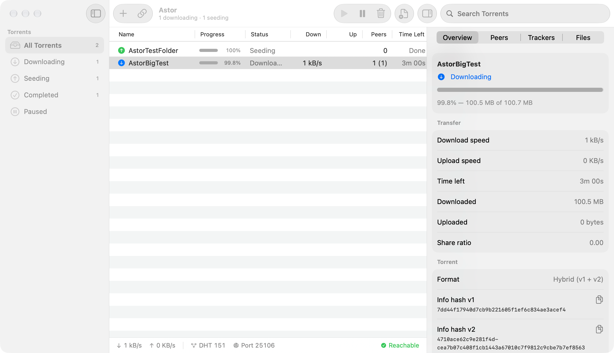

# Astor

A BitTorrent client written from scratch in Swift 6 for Apple Silicon.

* **Apple Silicon only** — macOS 26+ on M1 and later. The engine (`TorrentCore`) uses only
  BSD sockets, Dispatch, CryptoKit, Foundation and Security, so it can ship unchanged on
  iPhone/iPad chips later. No third-party dependencies.
* **Current protocols** — BitTorrent v2 and hybrid torrents, uTP, DHT with IPv6 and BEP 42
  security, PEX, magnet links, MSE/PE encryption, holepunching, web seeds.
* **Built for hard networks** — tuned for links where other clients crawl (ISP throttling,
  DNS blocking, VPN tunnels, NAT). `astor doctor` explains what limits your speed.

## Mac app

```sh
scripts/make-app.sh          # builds build/Astor.app (Liquid Glass, macOS 26+)
open build/Astor.app
```

Double-click `.torrent` files or click `magnet:` links in the browser to open them in Astor.
See [docs/APP.md](docs/APP.md).



## Quick start (CLI)

```sh
swift build -c release
.build/release/astor doctor                                  # check this network
.build/release/astor download ubuntu.torrent                 # or a magnet:?xt=… link
.build/release/astor download 'magnet:?xt=urn:btih:…' -o ~/Downloads --sequential
.build/release/astor info file.torrent
.build/release/astor create ~/Movies/MyVideo -o myvideo.torrent --tracker udp://tracker.opentrackr.org:1337/announce
```

Useful download options: `-e require` (encrypt every connection, which helps against ISP
throttling), `--seed`, `--select 0,2`, `--peer IP:PORT`, `--max-peers N`, `--down-limit`,
`--up-limit`, `--no-utp`, `--no-dht`, `-v` (peer table + diagnostics).

## Protocol support

| Area | BEPs / specs |
|---|---|
| Core wire protocol | BEP 3, 6 (Fast), 10 (extension protocol), 20 (peer id) |
| BitTorrent v2 & hybrid | BEP 52 (v2 metainfo, Merkle verification, piece layers, hash request serving), BEP 47 (padding files, attributes) |
| Metadata / magnets | BEP 9 (ut_metadata), magnet `btih`, `btmh` (v2), `tr`, `ws`, `x.pe`, BEP 53 (`so=` file selection) |
| Peer discovery | BEP 5 DHT, BEP 32 (IPv6 DHT), BEP 42 (DHT security), BEP 43 (read-only), BEP 11 PEX, BEP 14 LSD |
| Trackers | BEP 3/23 HTTP(S) compact, BEP 7 (IPv6 peers), BEP 12 multitracker, BEP 15 UDP, BEP 41 (UDP URL data), BEP 48 scrape |
| Transport | TCP, BEP 29 uTP (LEDBAT), BEP 55 holepunch, MSE/PE (RC4 obfuscation) |
| Other | BEP 19 web seeds, BEP 21 upload-only, BEP 27 private torrents, BEP 54 lt_donthave, BEP 40-style peer handling |
| NAT traversal | PCP (RFC 6887), NAT-PMP (RFC 6886), UPnP IGD |

## Why it's fast

* **Aggressive, correct peer discovery** — announces to every tracker in every tier at once,
  adds well-known open trackers to public torrents, queries DHT with α=8, uses PEX and LSD.
* **Many outgoing connections, fast** — up to 50 connection attempts per second and 200 peers
  per torrent. Encrypted first with plaintext fallback, and TCP first with uTP fallback.
* **Bandwidth-delay-product request pipelining** — each peer gets about 3 s of requests in flight
  (up to 500), with snub detection and endgame mode.
* **Apple Silicon hashing** — SHA-1/SHA-256 via CryptoKit on the ARMv8 SHA units, across all
  cores (`astor create` hashes at ~3.9 GiB/s on an M4).
* **Darwin-tuned I/O** — one serial Dispatch event loop for all sockets (measured as cheap
  as raw kqueue for 600 peers), sparse files on APFS, cached read-back verification, raised
  `RLIMIT_NOFILE`, and a uTP packet size fitted to tunnel MTUs.
* **DNS-over-HTTPS fallback** when the ISP's DNS blocks tracker hostnames.
* **Port mapping** (UPnP/NAT-PMP/PCP) so other peers can connect to you.

## Benchmark

Same torrent (Ubuntu 26.10 desktop ISO, a large public swarm), same 88 Mbit/s home
connection, 120 s from a cold start, the two clients run one after the other in both orders:

| Client | Run 1 | Run 2 |
|---|---|---|
| Transmission 4.1.4 | 2.74 MiB/s | 0.48 MiB/s |
| **Astor 0.1.0** | **9.91 MiB/s** | **10.86 MiB/s** (line rate) |

Astor reaches line speed within seconds: it announces to every tracker at once, re-queries
the DHT as soon as the routing table warms up, and keeps deep request pipelines. It also
accepts incoming peers through UPnP/NAT-PMP port mapping. Reproduce with `scripts/bench.sh`.

## Architecture

```
Sources/TorrentCore/
  Core/        EventLoop (single serial queue), hashing, Merkle trees, bitfield
  Net/         BSD sockets (TCP/UDP) on DispatchSource, addresses, DNS + DoH
  Bencode/     decoder/encoder with raw info-dict capture
  Metainfo/    v1/v2/hybrid parser, magnet links, torrent creator
  Peer/        wire protocol codec, PeerConnection (extensions, PEX, holepunch, hash serving)
  Session/     Session (sockets, scheduling, incoming detection), Torrent, PiecePicker
  Storage/     sparse files, pwrite/pread, verification, recheck
  MSE/         Diffie-Hellman (own big-int), RC4, encrypted stream
  UTP/         BEP 29 with LEDBAT congestion control
  DHT/         KRPC, routing table, iterative lookups, BEP 42 ids
  Tracker/     HTTP/UDP trackers, announce manager
  NAT/ LSD/    port mapping, local peer discovery
  WebSeed/     BEP 19 HTTP seeding
Sources/astor/ CLI (dashboard, info, create, doctor)
```

See [docs/ARCHITECTURE.md](docs/ARCHITECTURE.md) for the threading model and module
contracts.

## Tests

```sh
swift test                      # offline unit + loopback integration tests
ASTOR_LIVE=1 swift test         # also live DHT/tracker/interop tests (needs network, transmission-cli)
```

## License

MIT — see [LICENSE](LICENSE). Use Astor only for content you have the right to share.

## Authors

See [AUTHORS.md](AUTHORS.md).
